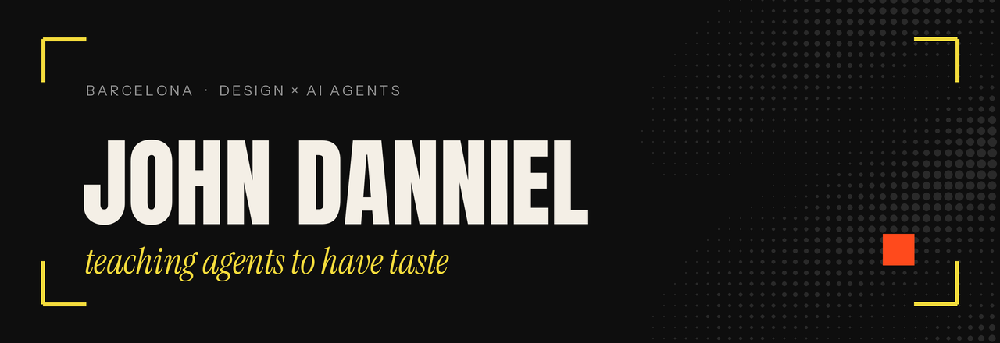

<p align="center">
  
</p>

# hey, I'm john

Advertising and design student in Barcelona. I build tools that give AI agents a designer's eye, and automations that do the boring parts of a studio.

<p>
  <a href="https://github.com/jdann1el/cropmark"></a>
  <a href="https://x.com/jdn1el"></a>
</p>

## Building

### [cropmark](https://github.com/jdann1el/cropmark)
An Agent Skill that makes Claude Code, Codex, Cursor and 70+ agents design YouTube thumbnails, posts and carousels at portfolio level. Blind test: it beat the same agent without the skill in 9 of 12 briefs.

```bash
npx skills add jdann1el/cropmark
```

<a href="https://github.com/jdann1el/cropmark"></a>

### [prospector](https://github.com/jdann1el/prospector)
Local lead prospecting from Google Maps, Instagram and Facebook, enriched and exported straight into an Obsidian CRM.

## Into

AI agents and computer use · AI-assisted development · automation · advertising and editorial design · algorithmic trading (paper only)

## Contact

<p>
  <a href="https://x.com/jdn1el"></a>
</p>
