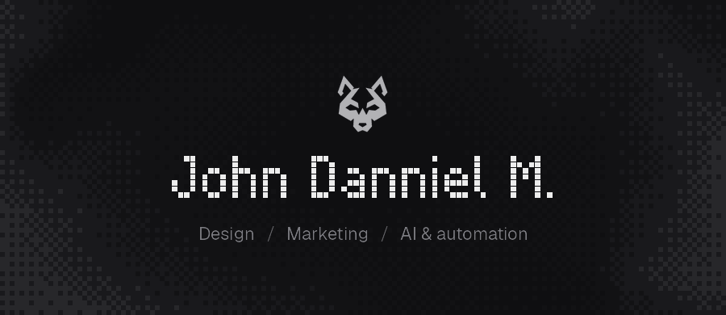

<p align="center">
  
</p>

<p align="center">
  <a href="https://github.com/jdann1el/cropmark"></a>
  <a href="https://x.com/jdn1el"></a>
  <a href="mailto:johndan.hq@gmail.com"></a>
</p>

## John Danniel

I build cool stuff where design meets AI.

Most of my time goes into automations and AI agents: workflows that do the repetitive part so the creative part gets more room. Design is where my creativity lives, AI is how I scale it, and the fun is in combining the two.

## Building

### [cropmark](https://github.com/jdann1el/cropmark) &nbsp; 

An open Agent Skill that makes Claude Code, Codex, Cursor and 70+ agents design YouTube thumbnails, posts and carousels at portfolio level. 18 style cards, two render engines, QA you can run. In a blind test it beat the same agent without the skill in 9 of 12 briefs.

```bash
npx skills add jdann1el/cropmark
```

<a href="https://github.com/jdann1el/cropmark"></a>

## Toolbox

<p>
  
</p>

## Contact

<p>
  <a href="https://x.com/jdn1el"></a>
  <a href="mailto:johndan.hq@gmail.com"></a>
  <a href="https://github.com/jdann1el/cropmark/issues"></a>
</p>
